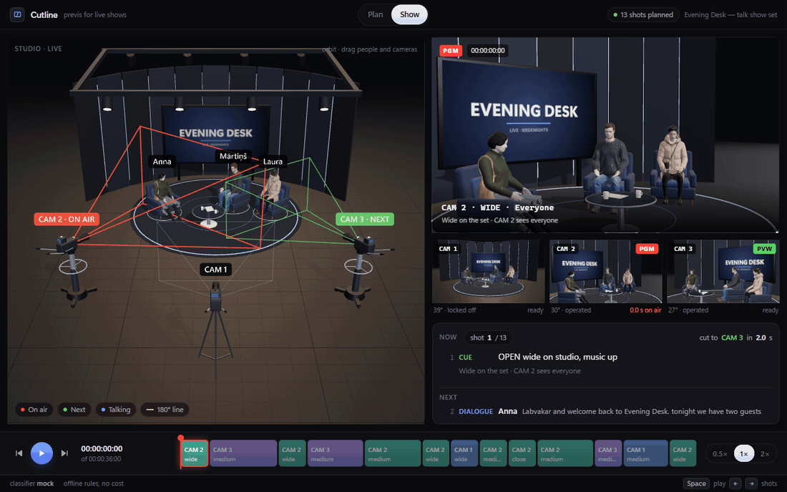

# Cutline

**AI reads text. Code does geometry.** Cutline turns a messy live-show rundown into a shot list, then plans every cut with a deterministic, unit-tested engine. AI is used in exactly one place: classifying lines of text (dialogue, action, cue…, who speaks, any requested shot size). Camera choice, framing, the 180° rule and cut timing are plain TypeScript functions. Every AI output is validated against a schema, and anything invalid or below 0.7 confidence is flagged for a human instead of being silently accepted.



## Run it (no API key needed)

```bash
npm install
npm run dev          # http://localhost:5173
```

Press **Load sample**, then **Parse**, then **Play**. The default `mock` classifier is rule-based and works offline.

## Use the Jev classifier

The main classifier is **Jev** by TypeSafe AI, a decision model. Jev does not write text. For each segment it answers four typed questions in one request: the row type, the speaker (a cast id or none), the shot size, and "does this line name a speaker who is not in the cast?". Each answer has a calibrated confidence, and that confidence goes straight into the sheet. Below 0.7, the cell is yellow.

```bash
cp .env.example .env         # then put your key in TYPESAFE_API_KEY
npm run dev:all              # vite + the classifier server on :8787
```

If the server has a TypeSafe key, the app selects **Jev**. Otherwise it selects **Mock**. The browser never sees a key. It posts each segment to `server/` (hono), which calls Jev through the official `@typesafe-ai/sdk`. The server checks each answer with zod, and the browser checks the result again against the studio. The footer shows the latency per row and the cost of the last parse. All question wording is in `server/jev-questions.ts`.

The **LLM** provider (Claude, `ANTHROPIC_API_KEY`) is for comparison only, so `npm run eval` can put the two side by side.

## Scripts

| Command | What it does |
| --- | --- |
| `npm run dev` | App only (mock classifier) |
| `npm run server` | Classifier server on `:8787` (reads `.env`) |
| `npm run dev:all` | Both |
| `npm test` | All offline tests. No network, no keys |
| `npm run test:live` | Live tests against Jev and Claude. Each runs only when its key is set |
| `npm run eval` | Classifier accuracy per field on the hand-labelled rundowns: average latency, total cost, every mismatch, and how many wrong answers review caught versus how many slipped through. `-- --provider jev\|llm\|mock`, or `-- --all`. Each run is saved to `docs/eval/` |
| `npm run typecheck` / `npm run lint` | strict TypeScript / ESLint |

Results from `npm run eval -- --all` on 37 rows (`docs/eval/`):

| provider | type | speaker | shot | avg ms | cost | caught | slipped |
|---|---|---|---|---|---|---|---|
| mock | 100.0% | 97.3% | 100.0% | 0 | n/a | 1 | 0 |
| jev (jev-1.14.0) | 100.0% | 100.0% | 100.0% | 182 | $0.001642 | 0 | 0 |

The one mock miss is on purpose: `she continues:` after a line from Mārtiņš. Rules guess the previous speaker, so the row is flagged yellow. Jev reads the previous rows and gets the speaker right.

## How it works

1. **Segment** (`src/classify/segment.ts`): lines, bracketed cues like `[GFX: …]`, and a new `NAME:` prefix after a sentence ends.
2. **Classify in a loop** (`src/classify/loop.ts`): one segment at a time, with the previous 5 rows as context. Locked rows (any row you edited) are matched by their text and never re-classified.
3. **Validate** (`src/classify/validate.ts`): an invalid field becomes `null` with confidence 0. Red = failed validation, yellow = confidence below 0.7.
4. **Cut engine** (`src/engine/`): for each row it chooses a shot size, checks which cameras see the subject at that FOV and see their face (≤ 60° off), keeps the 180° line of the current two-person exchange, scores `1·(1 − frontality/90) + 0.3·shotMatch − 1·sameAsPrevious` (ties by camera id), falls back to the widest camera that sees everyone, times rows (words ÷ 2.5 s, min 1.5 s, holds under 2 s merge into the previous shot), and writes a one-line reason.
5. **Preview** (`src/ui/`): one canvas with two drei `<View>`s, the studio overview and the program monitor rendered from the live camera at its FOV, plus a timeline. Drag people or cameras in the overview and the engine re-plans live.

Geometry (`src/geometry/`) works in metres and degrees: `y` up, yaw 0 faces −z, positive yaw turns left. Set dressing comes from part-list presets in 5 cm units (`src/models/`), converted once by the adapter.

## Docs

- [`docs/bug-log.md`](docs/bug-log.md): real bugs found while building, and how
- [`docs/decisions.md`](docs/decisions.md): non-obvious choices and where this build reads the spec a particular way
- [`docs/ideas.md`](docs/ideas.md): things deliberately not built

## Layout

```
src/model      types, zod schemas, constants (REVIEW_THRESHOLD = 0.7)
src/geometry   vectors, angles, inView, frontality, fovForShot, lineSide
src/models     preset adapter (5 cm → m) and presets
src/engine     cut engine rules and planner
src/classify   segmenter, mock + jev + llm providers, text extraction, validation, loop, eval
src/state      zustand store, edits, CSV export
src/ui         Script, Sheet, Studio, Monitor, Timeline
src/fixtures   sample studio (JSON) and rundowns with expected labels
server/        hono classifier endpoints: Jev (TypeSafe SDK) and the Anthropic API
tests/         vitest, mirroring src/; tests/live needs a key
```
